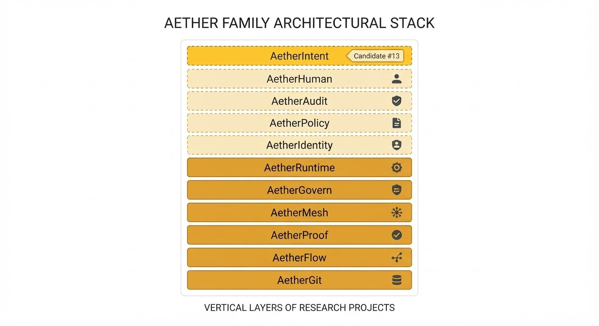
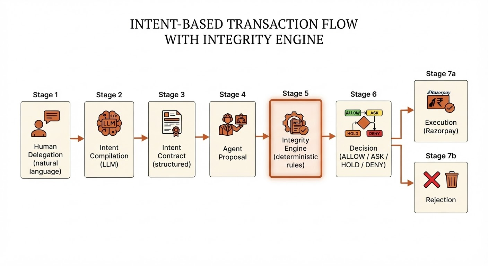
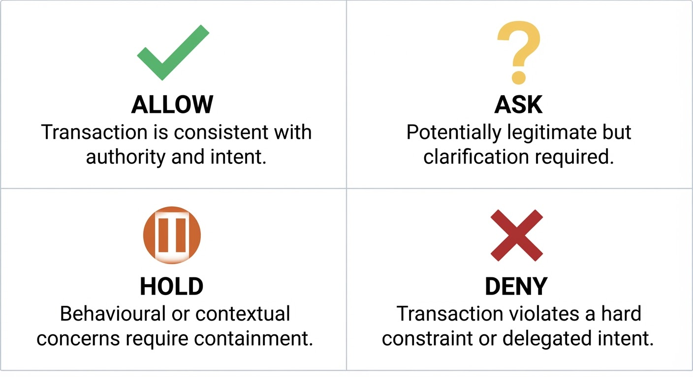
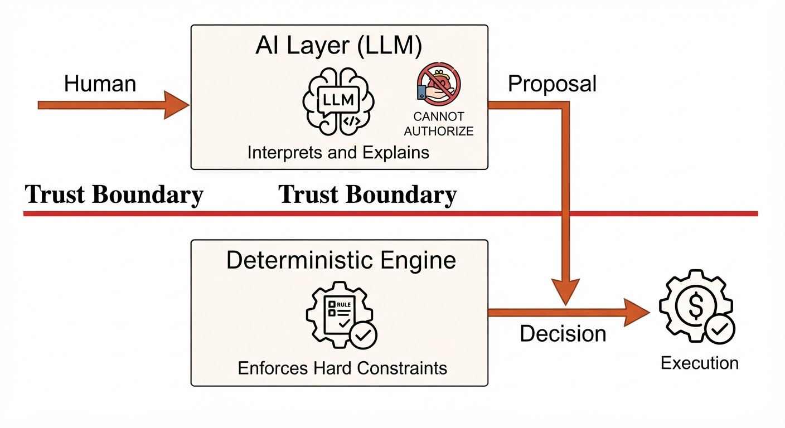
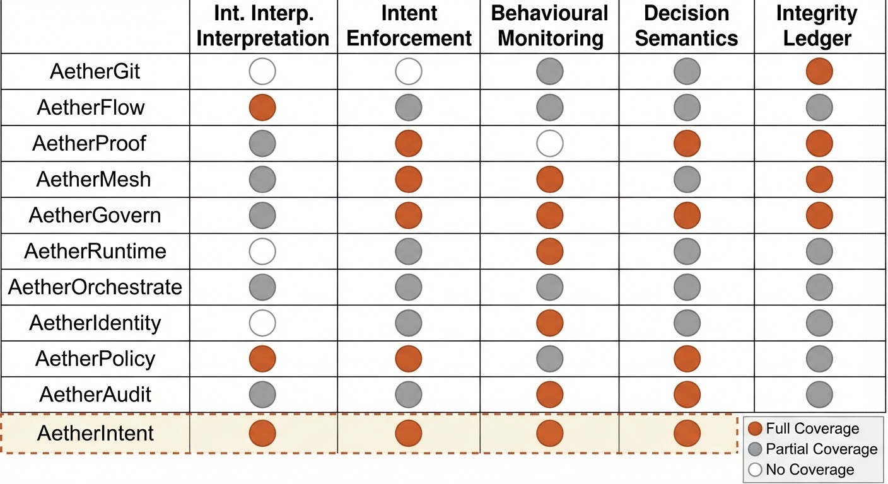

# AetherIntent — Research Repository

### Intent Integrity in Autonomous Economic Agent Systems

*A Falsification-First Investigation of Delegated Intent, Transaction Validity, and Deterministic Enforcement in Decentralized Multi-Agent Ecosystems*

[](https://doi.org/10.5281/zenodo.24417251)
[](https://doi.org/10.6084/m9.figshare.35082577)
[](https://creativecommons.org/licenses/by/4.0/)
[](https://orcid.org/0009-0003-8903-0029)


---

> **Status:** Phase 3 (Falsification Execution) — 3 SURVIVES, 1 NOT EXECUTABLE. Research repository, not a software repository. No implementation is planned unless the investigation supports it.
>
> **Decision:** (E) Undetermined (interim).
>
> **Structural dependency:** AetherIntent is structurally dependent on the resolution of AetherPolicy and AetherAudit (both paused at Phase 4).
>
> **Independent reviewer:** Jonathan Rabe (AI | ML Engineer, Angeles University Foundation), 2026-11-21.
>
> *"AetherIntent is a candidate, not a result."*

---

## Table of Contents

- [Overview](#overview)
- [Central Question](#central-question)
- [Seven-Stage Intent Flow](#seven-stage-intent-flow)
- [Candidate Responsibilities (M1–M5)](#candidate-responsibilities-m1m5)
- [Failure Conditions (II-F1 to II-F4)](#failure-conditions-ii-f1-to-ii-f4)
- [Propositions P1 and P2](#propositions-p1-and-p2)
- [Falsification Protocols (Phase 0–3)](#falsification-protocols-phase-03)
- [Coverage Analysis (Figure 5)](#coverage-analysis-figure-5)
- [Independent Review (Phase 2)](#independent-review-phase-2)
- [Evaluation Design (Phase 3, Proposal)](#evaluation-design-phase-3-proposal)
- [Decision (Phase 4, Interim)](#decision-phase-4-interim)
- [Repository Structure](#repository-structure)
- [Phase Status](#phase-status)
- [What This Repository Does Not Claim](#what-this-repository-does-not-claim)
- [Related Work](#related-work)
- [Related Aether Projects](#related-aether-projects)
- [Figures](#figures)
- [Figure Notes](#figure-notes)
- [Threats to Validity (T1–T7)](#threats-to-validity-t1t7)
- [Citation](#citation)
- [Author](#author)
- [License](#license)

---

## Overview

**AetherIntent** is the **thirteenth project (candidate)** of the Aether family. It investigates whether a genuine architectural gap exists between **delegated intent** (what a human meant when delegating authority to an agent) and the existing dimensions, in particular **AetherPolicy** (rules), **AetherAudit** (records), and **AetherGovern** (authority).

**AetherIntent is not a replacement for AetherPolicy, AetherAudit, or AetherGovern.** All remain dimensions or candidates with their own status. AetherIntent investigates whether prevention of financially valid but intent-violating transactions is a distinct responsibility that cannot be reduced to policy, audit, or governance.

This repository contains no `src/`, no `tests/`, and no `experiments/`. It **does** contain four **falsification protocols** that any reviewer can execute by hand (see [Falsification Protocols](#falsification-protocols-phase-03)).

| | |
|---|---|
| **Current release (v1.0.0)** | [Zenodo](https://doi.org/10.5281/zenodo.24417251) · [Figshare](https://doi.org/10.6084/m9.figshare.35082577) |
| **Length** | 31 pages, ~13,000 words (about 9,500 in Sections 1–12), 38 references |
| **PDF in this repo** | [`paper/AetherIntent_Research_Paper_v1.0.0.pdf`](paper/AetherIntent_Research_Paper_v1.0.0.pdf) |
| **Website** | [aetherintent.netlify.app](https://aetherintent.netlify.app) |

---

## Central Question

> Can an autonomous agent execute a financially valid transaction that violates the human's delegated intent, and can an independent deterministic enforcement layer prevent that execution?

The question has four clauses, each mapped to a failure condition:

| Clause | Condition |
|---|:-:|
| (i) Not already covered by Policy / Audit / Govern | **II-F1** |
| (ii) Does not decompose into Policy + Audit + Govern | **II-F2** |
| (iii) No central intent authority required | **II-F3** |
| (iv) Observable benefit | **II-F4** |

A positive answer needs all four. A negative answer on any one is sufficient to reject the candidate as a separate dimension.

---

## Seven-Stage Intent Flow

| Stage | Name | Guiding question |
|:-:|---|---|
| **S1** | Human Delegation | What did the human delegate, in natural language? |
| **S2** | Intent Compilation (LLM) | How is delegation translated into structured form? |
| **S3** | Intent Contract | What is the structured representation? |
| **S4** | Agent Proposal | What does the agent propose to execute? |
| **S5** | Integrity Engine (deterministic) | Does the proposal satisfy the intent contract? |
| **S6** | Decision (ALLOW / ASK / HOLD / DENY) | What is the outcome of deterministic verification? |
| **S7a / S7b** | Execution / Rejection | What happens after the decision? |

These seven are **not** assumed to be complete, independent, or necessary.

---

## Candidate Responsibilities (M1–M5)

| ID | Responsibility | Statement (hypothesis) | Principal reduction risk |
|:-:|---|---|---|
| **M1** | Intent Interpretation | Translating natural language into structured intent. | Performed by a language model outside the trust boundary; Policy and Flow hold full cells in the matrix; T4. |
| **M2** | Intent Enforcement | Deterministic verification of a proposal against the intent. | Proof, Mesh, Govern, and Policy hold full cells; T5. |
| **M3** | Behavioural Monitoring | Detecting deviations. | Five existing dimensions hold full cells (Mesh, Govern, Runtime, Identity, Audit). |
| **M4** | Decision Semantics | The outcomes ALLOW, ASK, HOLD, and DENY. | Proof, Govern, Policy, and Audit hold full cells; ASK is a boundary with AetherHuman. |
| **M5** | Integrity Ledger | Recording every proposal, decision, and execution. | Git, Proof, Mesh, and Govern hold full cells; AetherAudit holds partial. |

These five are **not** assumed to be complete, independent, or necessary.

---

## Failure Conditions (II-F1 to II-F4)

| ID | Claim under test | Status |
|:-:|---|---|
| **II-F1** | Non-redundancy: not already covered by Policy / Audit / Govern | 🟢 **SURVIVES (interim, SIGNED — Jonathan Rabe, 2026-11-21)** |
| **II-F2** | Non-decomposition: the intent verification does not decompose into Policy + Audit + Govern; a remainder survives | 🟢 **SURVIVES (interim, SIGNED — Jonathan Rabe, 2026-11-21)** |
| **II-F3** | Decentralizability: no central intent authority required | 🟢 **SURVIVES (interim, SIGNED — Jonathan Rabe, 2026-11-21)** |
| **II-F4** | Observable benefit: a benefit can be observed under a defined evaluation | ⚫ **NOT EXECUTABLE UNDER CURRENT PHASE CONSTRAINTS** |

> **"SURVIVES (interim, SIGNED)"** is not a final pass. Each verdict is subject to recorded residual risks (R1–R6 for II-F1, RR1–RR7 for II-F2, RR1–RR8 for II-F3).
>
> **"NOT EXECUTABLE"** is not a pass, and it is not a failure. II-F4 cannot be run under the current phase constraints (no implementation, no experiments).
>
> **Decision rule:** the candidate is accepted as an independent dimension only if all four conditions have been tested and none falsified, with II-F4 supported by measured results. The current evidence does not meet that threshold. The decision therefore remains **(E) Undetermined (interim)**.

---

## Propositions P1 and P2

| # | Proposition | Status |
|:-:|---|---|
| **P1** | The LLM cannot authorize: authorization must sit outside the interpretive component. | Proof sketch (not machine-checked) |
| **P2** | Intent validity is distinct from financial validity: a transaction can be financially valid and intent-invalid. | Proof sketch (not machine-checked) |

Neither is machine-checked.

---

## Falsification Protocols (Phase 0–3)

> **What this section is.** Four hand-executable protocols that any reviewer can run **without writing code**. Each protocol states: (1) the claim under test, (2) the pass/fail criterion, (3) numbered steps, (4) required artifacts, (5) expected output. Results are recorded in `FALSIFICATION/II-Fx_RESULT.md`.
>
> **What this section is not.** These are not code-level experiments. They do not require `src/`, `tests/`, or `experiments/`. They are the Phase 0–3 tests. Code-level experiments belong to Phase 6–7.

---

### Protocol 1 — II-F1 (Non-Redundancy)

**Result:** 🟢 SURVIVES (interim, SIGNED — Jonathan Rabe, 2026-11-21). See `FALSIFICATION/II-F1_RESULT.md` and `FALSIFICATION/II-F1_COVERAGE_ANALYSIS.md`.

**Summary:** For at least one `(T, C)` pair, no composition `R_Policy ∘ R_Audit ∘ R_Govern` produces the same DENY decision as `IE(T, C, H)`. Evidence: AetherPolicy Def 1 (φ over (a, c, s), not outcome), AetherAudit §1.2 (post-hoc, not pre-execution), AetherGovern v0.1.0 R1–R6 (authority, not outcome).

---

### Protocol 2 — II-F2 (Non-Decomposition)

**Result:** 🟢 SURVIVES (interim, SIGNED — Jonathan Rabe, 2026-11-21). See `FALSIFICATION/II-F2_RESULT.md` and `FALSIFICATION/II-F2_COMPOSITION_ANALYSIS.md`.

**Summary:** The pre-execution composition `C_pre = compose(R_Policy, R_Govern, R_Mesh)` cannot produce `ASK` or `HOLD` (codomain `{ALLOW, DENY}`), and cannot produce the same `DENY` as `IE` for an outcome predicate. The remainder is non-empty.

---

### Protocol 3 — II-F3 (Decentralizability)

**Result:** 🟢 SURVIVES (interim, SIGNED — Jonathan Rabe, 2026-11-21). See `FALSIFICATION/II-F3_RESULT.md` and `FALSIFICATION/II-F3_DECENTRALIZATION_ANALYSIS.md`.

**Summary:** IE's evaluation is a deterministic function of `(T, C, H)` (D3). No step requires a central authority. The distribution of `C` and `H` is supplied by AetherMesh, AetherAudit, and AetherGovern. The remaining challenges (synchronization, availability, lifecycle, divergent local decisions) are engineering problems, not architectural requirements.

---

### Protocol 4 — II-F4 (Observable Benefit)

**Result:** ⚫ NOT EXECUTABLE UNDER CURRENT PHASE CONSTRAINTS. See `FALSIFICATION/II-F4_STATUS.md`.

**Summary:** II-F4 requires an empirical test (implementation + experiments). Under current constraints (`implementation: none`, `experiments: none`), the test cannot be run. The design of scenarios (`ES1–ES5`) and metrics (`EM1–EM5`) can be prepared, but execution is not permitted. See [Evaluation Design](#evaluation-design-phase-3-proposal).

---

## Coverage Analysis (Figure 5)

The preliminary coverage matrix (Figure 5) assigns each of the five responsibilities (M1–M5) to each of the thirteen dimensions. The matrix reflects the author's **preliminary reading**, not a verified assessment.

| Responsibility | Covered fully by | Coverage classification |
|:-:|---|---|
| **M1** Intent Interpretation | Policy, Flow | Partial (LLM lies outside the trust boundary) |
| **M2** Intent Enforcement | Proof, Mesh, Govern, Policy | Partial (full cells exist but no single dimension owns it) |
| **M3** Behavioural Monitoring | Mesh, Govern, Runtime, Identity, Audit | **High** (five dimensions hold full cells) |
| **M4** Decision Semantics | Proof, Govern, Policy, Audit | Partial (ASK is a boundary with AetherHuman) |
| **M5** Integrity Ledger | Git, Proof, Mesh, Govern | Partial (AetherAudit holds partial) |

**Reading:** The matrix weighs **against independence**. Every responsibility is at least partially covered by an existing dimension. This is exactly what II-F2 (Protocol 2) must test — the "remainder" is what survives this coverage.

---

## Independent Review (Phase 2)

**Status:** ✅ **Completed** — signed by Jonathan Rabe (AI | ML Engineer, Angeles University Foundation) on 2026-11-21.

- **Recommendation:** Accepted the interim classification (E) Undetermined (interim).
- **Protocol questions answered:** H1–H3 (hypothesis), B1–B3 (boundary map), F1–F3 (falsification plan), D1–D3 (decision).
- **Refinements requested:** (1) clarify T1/T2 labels in A1–A6, (2) sharpen D1/D2 definitions. Both were addressed before Phase 3.
- **Full review:** [`REVIEW/INDEPENDENT_REVIEW.md`](REVIEW/INDEPENDENT_REVIEW.md)
- **II-F1–II-F3 sign-offs:** [`REVIEW/II-F1_SIGNED.md`](REVIEW/II-F1_SIGNED.md), [`REVIEW/II-F2_SIGNED.md`](REVIEW/II-F2_SIGNED.md), [`REVIEW/II-F3_SIGNED.md`](REVIEW/II-F3_SIGNED.md)
- **II-F4 status review:** [`REVIEW/II-F4_REVIEWED.md`](REVIEW/II-F4_REVIEWED.md)

---

## Evaluation Design (Phase 3, Proposal)

> **Status:** Proposal, not executed. This is a **design**, not a result.

The paper (§9) proposes five scenarios (`ES1–ES5`) and five metrics (`EM1–EM5`). They are summarized here.

**Scenarios:**

| ID | Scenario | What it tests |
|:-:|---|---|
| **ES1** | Financially valid, intent-valid | Baseline: ALLOW |
| **ES2** | Financially valid, intent-invalid | The central case: DENY expected |
| **ES3** | Financially invalid, intent-valid | Financial checks reject; IE must not override |
| **ES4** | Financially invalid, intent-invalid | Both reject; no double-counting |
| **ES5** | Ambiguous intent (ASK) | The boundary with AetherHuman |

**Metrics:**

| ID | Metric | Definition |
|:-:|---|---|
| **EM1** | Intent-violating transactions prevented | Count of ES2 cases correctly DENIED |
| **EM2** | False positives | Count of ES1 cases incorrectly DENIED |
| **EM3** | Decision determinism | Same `(T, C, H)` → same decision, across runs |
| **EM4** | Latency overhead | Added latency vs. Policy + Audit + Govern alone |
| **EM5** | Auditability | Fraction of decisions with a complete record (M5) |

**What would count as II-F4 = SURVIVES:** EM1 > 0, EM2 below an agreed threshold, EM3 = 100%, EM4 below an agreed threshold, EM5 = 100%.

**What would count as II-F4 = FALSIFIED:** No difference from Policy + Audit + Govern on any metric.

---

## Decision (Phase 4, Interim)

> **AetherIntent is classified as (E) Undetermined (interim).**
> The evidence is insufficient to accept AetherIntent as an independent dimension, and insufficient to reject it.

Full record: [`DECISIONS/INDEPENDENCE_DECISION.md`](DECISIONS/INDEPENDENCE_DECISION.md).

| Why insufficient to **accept** | Why insufficient to **reject** |
|---|---|
| II-F1–II-F3 SURVIVE on argument only (residual risks remain). | No failure condition has been falsified. |
| II-F4 is not executable under current phase constraints. | The intent-integrity question is coherent. |
| Structural dependency on AetherPolicy and AetherAudit (both unresolved). | Related work exists but does not settle the question. |

**"Undetermined" is not a failure.** It states that the evidence is insufficient to decide, and names what is missing.

---

## Repository Structure

```text
AetherIntent/
│
├── README.md
├── ARCHITECTURAL_HYPOTHESIS.md
├── ROADMAP.md
├── CHANGELOG.md
├── PROJECT_SUMMARY.txt
├── CITATION.cff
├── AUTHORS.md
├── CONTRIBUTING.md
├── INVENTORY.md
├── VERSION
├── manifest.json
├── scientific_state.json
├── netlify.toml
├── LICENSE
│
├── research/
│   └── RESPONSIBILITY_BOUNDARIES.md
│
├── FALSIFICATION/
│   ├── FALSIFICATION_PLAN.md
│   ├── II-F1_COVERAGE_ANALYSIS.md
│   ├── II-F1_RESULT.md
│   ├── II-F2_COMPOSITION_ANALYSIS.md
│   ├── II-F2_RESULT.md
│   ├── II-F3_DECENTRALIZATION_ANALYSIS.md
│   ├── II-F3_RESULT.md
│   └── II-F4_STATUS.md
│
├── DECISIONS/
│   └── INDEPENDENCE_DECISION.md
│
├── REVIEW/
│   ├── INDEPENDENT_REVIEW.md
│   ├── II-F1_SIGNED.md
│   ├── II-F2_SIGNED.md
│   ├── II-F3_SIGNED.md
│   └── II-F4_REVIEWED.md
│
├── REFERENCES/
│   └── README.md
│
├── docs/
│   └── figures/
│       ├── Fig1_Thirteen_Dimensions.png
│       ├── Fig2_Intent_Lifecycle.png
│       ├── Fig3_Four_Decisions.png
│       ├── Fig4_Trust_Boundary.png
│       └── Fig5_Coverage_Matrix.png
│
├── paper/
│   └── AetherIntent_Research_Paper_v1.0.0.pdf
│
├── PUBLICATION/
│   └── Netlify/
│       └── public/
│
└── REPORTS/
    └── architectural_investigation/
        ├── investigation_report.md
        └── README.md
```

No `src/`, no `tests/`, no `experiments/`, by design.

---

## Phase Status

| Phase | Description | Status |
|:-:|---|---|
| **0** — Architectural Hypothesis | The hypothesis is stated | ✅ Complete (`ARCHITECTURAL_HYPOTHESIS.md`) |
| **1** — Responsibility Mapping | Boundaries with existing dimensions | ✅ Complete (`research/RESPONSIBILITY_BOUNDARIES.md`) |
| **2** — Hypothesis Review | Independent review of the hypothesis | ✅ Complete (`REVIEW/INDEPENDENT_REVIEW.md`) |
| **3** — Falsification Execution | Execution of II-F1 to II-F4 | ✅ Complete (3 SURVIVES, 1 NOT EXECUTABLE) |
| **4** — Independence Decision | (E) Undetermined (interim) | ⚠️ Interim (`DECISIONS/INDEPENDENCE_DECISION.md`) |
| **5** — Architectural Specification | Requires a positive Phase 4 | ❌ Not permitted |
| **6** — Reference Implementation | Requires Phase 5 | ❌ Not permitted |
| **7** — Code-level Evaluation | Requires Phase 6 | ❌ Not permitted |

---

## What This Repository Does Not Claim

- ✖ That AetherIntent is an independent architectural dimension.
- ✖ That the seven flow stages are complete, independent, or necessary.
- ✖ That the five candidate responsibilities (M1–M5) are complete.
- ✖ That the boundaries with AetherPolicy, AetherAudit, AetherGovern, and the other dimensions are sufficient.
- ✖ That the gap is genuine.
- ✖ That implementation should begin.
- ✖ Any observed benefit (II-F4 is not executable under current constraints).
- ✖ Any causal effect.
- ✖ Any specification of an interface, schema, protocol, or prompt.

---

## Related Work

The paper cites the nearest neighbours as reservations on II-F1, not as support for the candidate:

- **Reference monitor** (Anderson, 1972) and **enforceable policies** (Schneider, 2000): motivation for a deterministic enforcement layer, and a limit on what can be enforced.
- **Audit logging** (Schneier & Kelsey, 1999; Crosby & Wallach, 2009): background for the integrity ledger (M5).
- **Confused deputy** (Hardy, 1988) and **capability systems** (Miller, 2006): background for the authority/intent boundary.
- **Indirect prompt injection** (Greshake et al., 2023) and **faithfulness of explanations** (Jacovi & Goldberg, 2020; Turpin et al., 2023): motivation for the trust boundary (P1).
- **Intention in philosophy and logic** (Bratman, 1987; Cohen & Levesque, 1990; Rao & Georgeff, 1995): vocabulary only, not an adopted framework.

The comparison with the field is treated as open and is a reservation on II-F1.

---

## Related Aether Projects

| # | Project | Status | DOI |
|:-:|---|---|---|
| 1 | AetherGit | Foundational | [10.5281/zenodo.23966896](https://doi.org/10.5281/zenodo.23966896) |
| 2 | AetherFlow | Foundational | [10.5281/zenodo.23979129](https://doi.org/10.5281/zenodo.23979129) |
| 3 | AetherProof | Foundational | [10.5281/zenodo.24013124](https://doi.org/10.5281/zenodo.24013124) |
| 4 | AetherMesh | Foundational | [10.5281/zenodo.24038038](https://doi.org/10.5281/zenodo.24038038) |
| 5 | AetherGovern | Foundational | [10.5281/zenodo.24054524](https://doi.org/10.5281/zenodo.24054524) |
| 6 | AetherRuntime | Foundational | [10.5281/zenodo.24078477](https://doi.org/10.5281/zenodo.24078477) |
| 7 | AetherOrchestrate | Foundational | [10.5281/zenodo.24095399](https://doi.org/10.5281/zenodo.24095399) |
| 8 | AetherIdentity | Candidate | [10.5281/zenodo.24102739](https://doi.org/10.5281/zenodo.24102739) |
| 9 | AetherPolicy | Candidate (Phase 4: paused) | [10.5281/zenodo.24160047](https://doi.org/10.5281/zenodo.24160047) |
| 10 | AetherAudit | Candidate (Phase 4: paused) | [10.5281/zenodo.24274628](https://doi.org/10.5281/zenodo.24274628) |
| 11 | AetherHuman | Candidate (Phase 4: paused) | [10.5281/zenodo.24278322](https://doi.org/10.5281/zenodo.24278322) |
| 12 | AetherMemory | Candidate (interim) | [10.5281/zenodo.24372288](https://doi.org/10.5281/zenodo.24372288) |
| 13 | **AetherIntent** | Candidate (this repository; Phase 3) | [Zenodo](https://doi.org/10.5281/zenodo.24417251) · [Figshare](https://doi.org/10.6084/m9.figshare.35082577) |

---

## Figures

Figures 1 to 5 are described in the paper and stored in [`docs/figures/`](docs/figures/).

### Figure 1 — The Thirteen Dimensions of the Aether Family



*Seven foundational dimensions and six candidates. AetherIntent is the newest candidate.*

### Figure 2 — AetherIntent Intent Lifecycle (Seven Stages)



*Human delegation, LLM compilation, intent contract, agent proposal, integrity engine, decision, execution/rejection. Each stage is a hypothesis, not a specification.*

### Figure 3 — The Four Decisions (ALLOW / ASK / HOLD / DENY)



*The four-outcome decision vocabulary. ASK and HOLD destinations are treated as open.*

### Figure 4 — The Trust Boundary



*Interpretation (LLM) and enforcement (deterministic engine) sit on opposite sides of the trust boundary.*

### Figure 5 — Coverage Matrix: Responsibilities × Existing Dimensions



*The matrix reflects the author's preliminary reading, not a verified assessment. The full coverage assigned to Policy, Audit, and Govern is the remainder that II-F2 must test, and it weighs against independence.*

---

## Figure Notes

| Figure | Observation |
|:-:|---|
| **Fig 1** | The stack is a graphical convention, not a dependency-order assertion. |
| **Fig 2** | The flow is linear. There is no path from Stage 6 (Decision) back to Stage 1 (Delegation), although an ASK outcome implies that the human is consulted. This interaction with AetherHuman is a boundary question. |
| **Fig 3** | ASK and HOLD destinations are not drawn. The paper treats them as open. |
| **Fig 4** | The trust boundary hypothesis places interpretation (LLM) and enforcement (deterministic engine) on opposite sides. |
| **Fig 5** | The matrix reflects the author's preliminary reading, not a verified assessment. The full coverage assigned to Policy, Audit, and Govern is the remainder that II-F2 must test, and it weighs against independence. |

---

## Threats to Validity (T1–T7)

| # | Threat | Description |
|:-:|---|---|
| **T1** | Author-on-author reasoning | The hypothesis and the decision are written by the same author. |
| **T2** | No independent review | Resolved: signed by Jonathan Rabe (2026-11-21). Residual risk of "single reviewer" remains. |
| **T3** | Structural dependency on AetherPolicy and AetherAudit | Both are paused at Phase 4; any conclusion is conditional. |
| **T4** | LLM interpretability | The LLM may misinterpret the delegation; the integrity engine cannot fix a bad interpretation. |
| **T5** | Scope of intent validity | "Intent validity" may be a semantic notion, not an architectural one. |
| **T6** | No measurement | II-F4 is not executable under current constraints; no evaluation has been run. |
| **T7** | Related work may already cover the gap | The comparison with the field is open. |

---

## Citation

Machine-readable metadata is in [`CITATION.cff`](CITATION.cff) (GitHub shows a "Cite this repository" button).

```bibtex
@misc{baladi2026aetherintent,
  author    = {Baladi, Samir},
  title     = {AetherIntent: Intent Integrity in Autonomous Economic Agent Systems},
  year      = {2026},
  version   = {1.0.0},
  publisher = {Zenodo},
  doi       = {10.5281/zenodo.24417251},
  url       = {https://doi.org/10.5281/zenodo.24417251},
  note      = {Mirror: https://doi.org/10.6084/m9.figshare.35082577; Architectural investigation; Phase 3: (E) Undetermined (interim)}
}
```

---

## Author

**Samir Baladi**
Interdisciplinary AI Researcher, Ronin Institute / Rite of Renaissance

| | |
|---|---|
| **Email** | [gitdeeper@gmail.com](mailto:gitdeeper@gmail.com) |
| **ORCID** | [0009-0003-8903-0029](https://orcid.org/0009-0003-8903-0029) |
| **GitHub** | [gitdeeper15/aetherintent](https://github.com/gitdeeper15/aetherintent) |
| **GitLab** | [gitlab.com/gitdeeper15/aetherintent](https://gitlab.com/gitdeeper15/aetherintent) |
| **Codeberg** | [codeberg.org/gitdeeper15/aetherintent](https://codeberg.org/gitdeeper15/aetherintent) |
| **Bitbucket** | [bitbucket.org/gitdeeper15/aetherintent](https://bitbucket.org/gitdeeper15/aetherintent) |
| **Website** | [aetherintent.netlify.app](https://aetherintent.netlify.app) |
| **Zenodo (v1.0.0, current)** | [10.5281/zenodo.24417251](https://doi.org/10.5281/zenodo.24417251) |
| **Figshare (mirror)** | [10.6084/m9.figshare.35082577](https://doi.org/10.6084/m9.figshare.35082577) |

---

## License

CC-BY-4.0 (this document). MIT (code, future; none in this release).

---

**AetherIntent v1.0.0 — Intent Integrity**

© 2026 Samir Baladi — Ronin Institute / Rite of Renaissance
Zenodo DOI (v1.0.0): 10.5281/zenodo.24417251 · Figshare DOI: 10.6084/m9.figshare.35082577

***AetherIntent is a candidate, not a result.***
